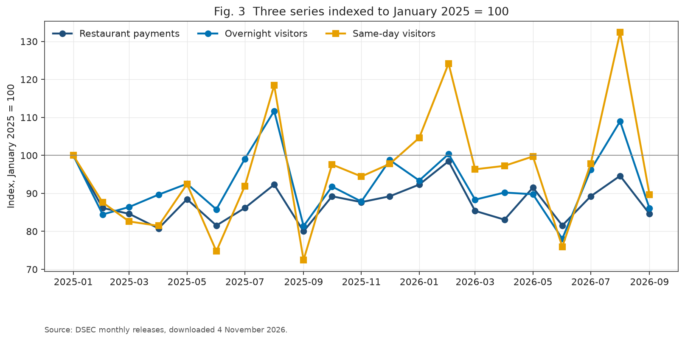
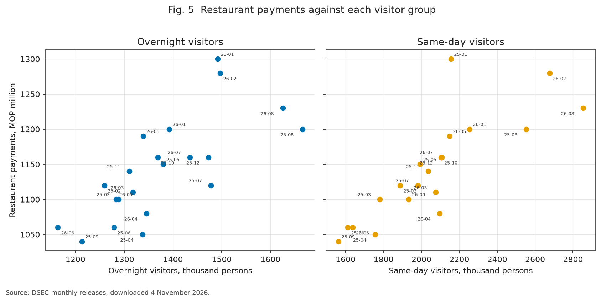

# Inbound Tourism and Electronic Payment Activity in Macao's Restaurant Sector

**Course:** CISC7204 Data Science and Data Visualization  
**Team:** Class D – Team 01  
**Study period:** January 2025 to September 2026  
**Status:** Analysis completed; peer review and portfolio publication pending

## Project overview

This project examines whether monthly overnight and same-day visitor arrivals move together with the electronic payment transaction value of restaurants and similar establishments in Macao. It uses 21 months of public aggregate statistics from the Statistics and Census Service of Macao (DSEC).

The dependent variable is **restaurant electronic payment transaction value**, not restaurant revenue or total turnover. The payment series excludes cash, includes spending by residents as well as visitors, and can change when customers shift between payment methods.

## Research question

Between January 2025 and September 2026, how were monthly overnight and same-day visitor arrivals associated with the electronic payment transaction value of restaurants and similar establishments in Macao?

The project uses the language of **association**, not causation. The short time series can describe co-movement but cannot establish that changes in visitor arrivals caused changes in restaurant payments.

## Data sources and permissions

- [Statistics on Electronic Payment Transaction Value – Restaurants and Similar Establishments and Retail Trade](https://www.dsec.gov.mo/en-US/Statistic?d=31919&id=502), DSEC.
- [Visitor Arrivals](https://www.dsec.gov.mo/en-US/Statistic?d=31883&id=402), DSEC.

All source materials used here are public, aggregate statistical releases. DSEC statistical publications state that reproduction of statistical data is allowed when the source is identified. This repository identifies DSEC in the data documentation and on every figure. Users should consult the linked source pages for the current usage conditions before redistributing source files.

The files were downloaded on 4 November 2026. The latest common month was September 2026. `data/DATASETS.md` explains the archived files and `codebook.md` defines every analysis column. The raw source material contains no individual-level records.

## Methods and tools

The analysis was completed in Python using pandas, NumPy, Matplotlib, SciPy and statsmodels. The notebook:

1. reads the archived DSEC releases and payment levels;
2. extracts same-day and overnight visitor counts;
3. checks that the two visitor groups sum to the total used;
4. merges the two sources by calendar month without interpolation;
5. calculates indexed values, year-on-year growth and month-to-month changes;
6. reports Pearson and Spearman correlations;
7. fits an exploratory ordinary least squares regression; and
8. checks collinearity, influential months, residual autocorrelation and coefficient stability.

## Key findings

- Restaurant electronic payments moved positively with both visitor groups during the 21-month sample.
- In levels, the Pearson correlation was **0.815** for same-day arrivals and **0.730** for overnight arrivals.
- In month-to-month changes, the corresponding correlations were **0.879** and **0.833**.
- In the two-predictor model, an additional thousand same-day visitors was associated with approximately **MOP 0.152 million** more monthly electronic payment value, holding overnight arrivals constant.
- The estimated overnight coefficient was approximately **MOP 0.079 million per thousand visitors**, but its 95% confidence interval crossed zero.
- The two visitor groups moved closely together, so their separate coefficients should not be interpreted as stable causal effects.

## Selected visualizations

### Relative monthly movement



Same-day arrivals moved further above the January 2025 baseline than restaurant payments did. Shared holiday peaks can strengthen correlations in the level series, so the analysis also compares month-to-month changes.

### Payments and visitor groups



The same-day visitor panel shows a somewhat tighter positive relationship with restaurant electronic payments. Because overnight and same-day arrivals also move together, this comparison does not isolate their independent contributions.

All six figures are available in the `visuals/` folder and are regenerated by the notebook.

## Limitations

- The sample contains only 21 monthly observations and covers just over one seasonal cycle.
- Electronic payments exclude cash and include resident spending, so they are not a direct measure of visitor spending or total restaurant receipts.
- Overnight and same-day arrivals are strongly correlated, which makes their separate regression coefficients less precise.
- Events, exchange rates, resident consumption and shifts from cash to electronic payment are not included in the model.
- The results may change when DSEC publishes additional months or revises recent observations.

## Repository structure

```text
.
├── README.md
├── FEEDBACK.md
├── codebook.md
├── requirements.txt
├── data/
│   ├── DATASETS.md
│   ├── merged_monthly.csv
│   ├── payment_levels.csv
│   └── archived DSEC source files
├── notebooks/
│   └── cisc7204_Class_D_Team_01_analysis.ipynb
└── visuals/
    └── Figures 1–6
```

## Reproduction instructions

Python 3.10 or later is recommended.

```bash
python3 -m venv .venv
source .venv/bin/activate
python -m pip install -r requirements.txt
jupyter notebook notebooks/cisc7204_Class_D_Team_01_analysis.ipynb
```

In Jupyter, select **Kernel → Restart Kernel and Run All Cells**. Run the notebook from this repository without moving it out of `notebooks/`. It reads the archived files in `data/` and rewrites `data/merged_monthly.csv` and the six PNG files in `visuals/`.

A correct run should produce:

- 21 consecutive months from January 2025 to September 2026;
- a revised January 2025 payment value of MOP 1.30 billion;
- same-day plus overnight arrivals equal to the total used within five persons;
- level correlations of approximately 0.815 and 0.730; and
- two-predictor slopes of approximately 0.152 and 0.079.

The notebook was successfully tested from start to finish in a clean temporary environment on 14 November 2026. It reproduced the existing 21-row merged dataset and all six figure images exactly. An independent classmate rerun is still required before final portfolio submission.

## Team and individual contribution

This is a team project by **CHEN RUXIN, GUO JINZHENG, CHAN CHENG I, SUN JIA, BAI HAOCHENG and XIE ZIQI**.

For this portfolio copy, **CHEN RUXIN** served as Coordinator and Scribe: setting agendas, chairing meetings, preparing minutes and integrating report text. The analysis, data checking, figures and quality review were collaborative team outputs. This repository does not claim that one person completed the full project independently.

Peer feedback and the corresponding revision commit will be recorded in [`FEEDBACK.md`](FEEDBACK.md) before submission.
